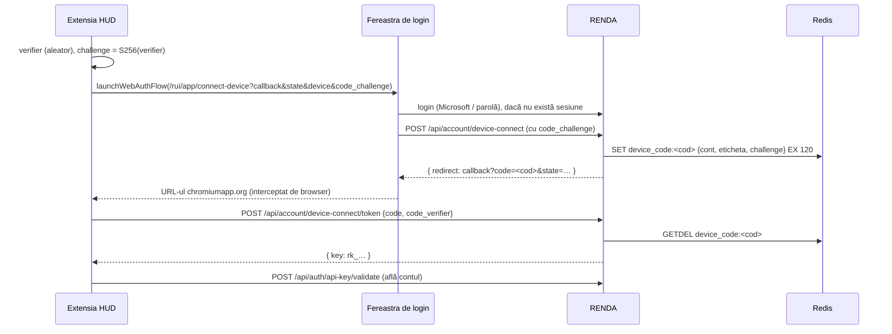

# Spec server RENDA pentru extensia RENDA HUD

23.09.2026 · revizuit după planul „RENDA HUD: server-side plan (SHKN in CMS)” și review-ul lui

## Rezumat

Extensia RENDA HUD (Chrome/Edge, pe chatgpt.com) își ia datele de pe RENDA, nu din propriul repo
public. Acel repo ține azi registrul BOOT cu 73 de persoane, SHKN, subscripția Azure și ID-urile de GPT.
Partea din extensie e gata (v4.37.0, branch `feat-enh`), inclusiv conectarea v2 descrisă în Faza 2.

**Decizii:**

| Cod | Decizie |
| --- | --- |
| HUD-1 | GPT-urile, GPT-urile externe, skills, aplicațiile ChatGPT și modelele de rol sunt gate-uri de tip `chatgpt`. Fără tabele noi. |
| HUD-2 | Misiunea, acțiunile, departamentul și textul de boot al unei persoane stau pe profilul ei (`meta.role`). |
| HUD-3 | O extensie de browser se conectează doar prin fluxul cu cod de unică folosință (v2, PKCE). Adresa de întoarcere poartă un cod, niciodată cheia. Copilot și Archivr rămân pe v1, neschimbate. |
| HUD-4 | Lista de angajați e doar internă: `/api/sett/lists` **și** `/api/user_data/business`. |
| HUD-5 | SHKN = articole CMS `kb` într-un singur workspace „SHKN”. Articolul CMS e singura copie. |

**Faze și ordinea livrării:**

| Fază | Ce | Livrare | Efort estimat |
| --- | --- | --- | --- |
| 0 | decizii în registru + epic în `TODO.md` | — | 0,5 ore |
| 1 | lista de angajați doar internă (HUD-4) | **deploy separat, imediat** (reparație de securitate) | 0,5–1 zi |
| 2 | device-connect v2 pentru extensii | deploy 2 (deblochează butonul din extensie) | 2–3 zile |
| 3 | rolul pe profil + importer + `GET /api/hud/me` | deploy 3 | 1,5–2 zile |
| 4 | gate-uri `chatgpt` + filtrul de tipuri nerulabile + sincronizare | deploy 3 | 2–3 zile |
| 5 | SHKN în CMS | deploy 3 | 1 zi |
| 6 | `GET /api/hud/config` | deploy 3 | 1 zi |
| 7 | specificații, `TODO.md` | — | 0,5 zile |

Extensia e compatibilă cu orice ordine de livrare. Dacă un endpoint lipsește sau răspunde cu eroare,
folosește datele din pachet, fără crash.

## Faza 0. Înregistrarea deciziilor

- În registrul de decizii: HUD-1…HUD-5 din tabelul de mai sus, autor Radu, 23.09.2026.
- În `TODO.md`: epic nou **11. RENDA HUD server side**, cu fazele 1–7 ca sarcini.

## Faza 1. Lista de angajați doar internă (HUD-4)

Azi două rute dau oricărui cont autentificat (inclusiv extern sau o cheie Bearer) datele angajaților:

| Rută | Unde | Ce expune |
| --- | --- | --- |
| `GET /api/sett/lists` | `organization_api.ts:96` → `DIRECTORY_list` (`organization_service.ts:381`) | proiecte, angajați cu email și telefon, companii |
| `GET /api/user_data/business` | `server_routes.ts:79` → `fetch_business_data` (`app_data_service.ts:61`) | aceleași liste (`load_sett_lists`) + `people`: numele și emailul tuturor angajaților activi (`load_people`, `app_data_service.ts:238`) |

**Schimbări:**

- `DIRECTORY_list(search, actor)`: întâi `ACCOUNT_is_internal(actor)` (`src/erp/account_internal.ts:19`); altfel `FORBIDDEN`. Ruta trimite `ctx.account`.
- `fetch_business_data(account)`: pentru un cont care nu e intern, `employees` și `people` vin goale (`[]`). Restul listelor rămân, ca interfața să funcționeze pentru conturile externe. **Nu** se întoarce 403 aici: ambele interfețe RENDA încarcă această rută la pornire.
- Criteriul „angajat” din listă trece pe regula CIM (contract de muncă) din Decizia #1, nu doar pe `crm_entity_account` activ, ca să nu mai apară contactele clienților ca angajați.

**Teste:**

- `/api/sett/lists`: cont intern → 200; cont extern → 403 (verificat pe statusul HTTP); fără autentificare → 401.
- `/api/user_data/business`: cont intern → `employees` și `people` completate; cont extern → ambele `[]`, restul listelor prezente.
- un contact de client fără CIM nu mai apare între angajați.
- **Manual:** interfața React și cea Van se deschid fără erori cu un cont extern.

## Faza 2. Device-connect v2 pentru extensii (HUD-3)

**v2 există pe `main` din `84482a0a1`** („copilot: … conectare v2 (PKCE)”), pentru bucla locală:
`DEVICE_CONNECT_issue` emite un cod, `DEVICE_CONNECT_exchange` îl schimbă pe cheie. Faza aceasta doar
**acceptă callback-ul extensiilor și îl obligă pe v2**. v1 rămâne pentru Archivr și Copilot < 1.5.
Forma de mai jos e cea implementată (verificată pe `1c86d904b`, 23.09.2026).



Cheia se creează abia la schimb. Un cod abandonat nu lasă o cheie orfană în contul userului.

### 2.1 Validatorul (`src/api_keys/api_key.shared.ts`)

- **Funcție nouă** `device_callback_kind(url): 'loopback' | 'browser_extension' | null`:

  | | `loopback` (azi) | `browser_extension` (nou) |
  | --- | --- | --- |
  | protocol | `http:` | `https:` |
  | gazdă | `127.0.0.1` sau `localhost` | `^[a-p]{32}\.chromiumapp\.org$`, ancorat la ambele capete |
  | port | obligatoriu | obligatoriu gol |
  | utilizator/parolă în URL | interzise | interzise |

- **`DeviceConnectInput`** primește `code_challenge?` și `code_challenge_method?`.
- **`device_connect_problem`** adaugă trei reguli:
  - `browser_extension` fără `code_challenge` → `'a browser extension must use the one-time code flow'`;
  - `code_challenge` prezent → exact 43 de caractere base64url (`CHALLENGE_SHAPE`), cu `code_challenge_method === 'S256'` (implementat deja pentru v2);
  - regulile existente pentru `state` și `device` rămân.
- Bucla locală cu `code_challenge` e acceptată (v2 opțional, pentru un Copilot viitor). Fără el, rămâne v1.

### 2.2 Pagina de connect

- `connect_device_search.ts`: citește și `code_challenge` (max. 128) și `code_challenge_method` (max. 8); le trimite în corpul `POST /api/account/device-connect`.
- `connect_device_page.tsx` afișează unde pleacă cheia, calculat din callback, nu din `device` (numele îl alege aplicația, deci nu dovedește nimic). Două chei noi de traducere în `public/locales/*.json`:

  | Tip | Cheie | en | ro |
  | --- | --- | --- | --- |
  | `loopback` | `account.device_connect.dest_loopback` | The key goes to an app on this computer. | Cheia merge la o aplicație de pe acest calculator. |
  | `browser_extension` | `account.device_connect.dest_extension` | The key goes to a browser extension (ID `{{id}}`). | Cheia merge la o extensie de browser (ID `{{id}}`). |

- Anularea rămâne `callback?error=access_denied&state=…`, pentru ambele versiuni.

### 2.3 Emiterea codului (`POST /api/account/device-connect`, cu `code_challenge`)

- Cere în continuare `SESSION_is_interactive`, deci doar userul logat în browser poate aproba.
- **Codul:** 32 de octeți aleatori în base64url (43 de caractere).
- **Stocare** în Redis, după modelul `LINK_CODE_create/consume` din `cont.md`:
  - cheia: `device_code:<cod>`;
  - valoarea: `{ account_uuid, label, challenge }` (`DeviceConnectCode`);
  - durata: `DEVICE_CONNECT_CODE_TTL_SECONDS = 120` (2 minute);
  - merge pe ambele instanțe, fiind în Redis.
- **Răspuns:** `{ redirect: "<callback>?code=<cod>&state=<state>" }`. Parametrii existenți din callback se păstrează. **Fără cheie.**

### 2.4 Schimbul (`POST /api/account/device-connect/token`), endpoint nou

| | |
| --- | --- |
| Autentificare | niciuna; dovada e verificatorul PKCE. Ruta e publică, ca `/token` din OAuth. |
| Corp | exact `{ "code": "…", "code_verifier": "…" }` (`DEVICE_CONNECT_TOKEN_BODY`); codul 43–128 caractere base64url |
| Pași | `GETDEL device_code:<code>` → există; `base64url(SHA-256(code_verifier)) === challenge`; `PERM_for_account(account_uuid)` → `api_key_insert(account, label, …, 'device')` |
| Răspuns 200 | `{ ok: true, data: { key: "rk_…" } }`. Extensia validează apoi cheia cu `POST /api/auth/api-key/validate`, ca să afle contul. Un `account` în răspuns ar scuti acest apel (opțional). |
| Erori | `400 invalid_grant` pentru orice nepotrivire (cod necunoscut, expirat, deja folosit, verificator greșit, alt callback). Același mesaj pentru toate, ca să nu se ghicească ce a fost greșit. `429` peste limita de rată. |
| Limită de rată | 10 cereri / minut / IP |
| Audit | `ACCOUNT_KEY_CREATE` cu `created_via: 'device'`, `flow: 'v2'` |

- Codul e consumat (`GETDEL`) **înainte** de verificări. O încercare greșită îl invalidează, deci nu se poate ghici verificatorul prin încercări repetate.
- `code_verifier`: `^[A-Za-z0-9_-]{43,128}$` (RFC 7636); altfel 400.
- Contul trebuie încărcat după `account_uuid`, pentru că nu există sesiune. Snapshot-ul de permisiuni din Redis, cerut de `ACCOUNT_for_token`, există deja: userul tocmai s-a logat în browser.

### 2.5 Ce face extensia (implementat, v4.37.0)

- **Trimite** la `/rui/app/connect-device`: `callback = chrome.identity.getRedirectURL()`, `state` de 32 de caractere hex, `device = "RENDA HUD pe Chrome|Edge"`, `code_challenge` (S256, 43 de caractere), `code_challenge_method=S256`.
- **Acceptă** la întoarcere doar `code` + `state` identic. Un răspuns cu `key` în adresă e respins.
- **Schimbă** codul la `/api/account/device-connect/token` cu exact `{ code, code_verifier }` și păstrează cheia doar în `chrome.storage.local`.
- **Află contul** din `account`, dacă răspunsul îl conține; altfel (azi) cheamă `POST /api/auth/api-key/validate`.
- **Testat** în `tests/background.test.mjs`, cu un server simulat care verifică PKCE ca unul real.

### 2.6 Teste pe server

| Caz | Așteptat |
| --- | --- |
| extensie, v2 complet | redirect cu `code` (fără `key`); schimbul → cheie `rk_`, 365 de zile, numele = `device` |
| extensie fără `code_challenge` (v1) | respins |
| `code_challenge_method` ≠ `S256` / provocare cu formă greșită | respins |
| schimb cu verificator greșit | 400; codul e consumat, un al doilea schimb corect → tot 400 |
| schimb după 120 de secunde | 400 |
| același cod schimbat de două ori | al doilea → 400 |
| anulare pe pagină | `error=access_denied`, niciun cod în Redis, nicio cheie |
| `https://<id>.chromiumapp.org:8443/`, `http://<id>.chromiumapp.org/`, `https://<id>.chromiumapp.org.evil.com/`, ID de altă lungime sau cu literă în afara `a`–`p`, `https://user:pw@<id>.chromiumapp.org/` | respinse |
| bucla locală v1 (toate cazurile de azi) | neschimbate |
| UI | pagina afișează `dest_extension` cu ID-ul, respectiv `dest_loopback` |

**Documentație:** `cont.md` (rândul 197 devine „implementat pentru extensii”) și `canale.md`.

## Faza 3. Rolul pe profil + `GET /api/hud/me` (HUD-2)

### 3.1 `ProfileRole` (`src/erp/erp_types.ts:194`)

Se adaugă `departament?: string` și `actiuni?: string[]` (maximum 3). Restul câmpurilor rămâne.

### 3.2 Importerul de roluri

Azi nimic din `src/` nu scrie `meta.role`: datele existente au venit dintr-un import făcut o singură dată.

| | |
| --- | --- |
| Rută | `PUT /api/sett/profile/roles` |
| Acces | creAItor sau HR |
| Corp | `{ "dry_run": true, "roles": [{ "uuid": "…", "role": ProfileRole }] }` |
| Potrivire | **doar după uuid** (DECISIONS #31); niciodată după nume sau email |
| Efect | o singură instrucțiune SQL care setează `meta.role` pentru uuid-urile găsite; cu `dry_run: true` nu scrie nimic |
| Răspuns | `{ updated: n, unchanged: n, unknown_uuids: [...], changes: [{ uuid, name, fields_changed }] }` |
| Audit | vechi și nou, pe fiecare profil schimbat |

**Pasul care lipsea: numele → uuid.** Foaia BOOT are nume, nu uuid-uri și nici emailuri. Înainte de import:

1. HR exportă lista angajaților activi cu uuid (`GET /api/sett/payroll/salary-schemes` o dă deja, pentru HR).
2. În foaie se adaugă o coloană `uuid`, completată pe baza acelei liste.
3. Importul rulează întâi cu `dry_run: true`. Se verifică `unknown_uuids` și `changes` (numele din răspuns vine din profil, deci o potrivire greșită se vede), apoi se rulează real.

### 3.3 `GET /api/hud/me`

| | |
| --- | --- |
| Autentificare | Bearer (`rk_`, `rnd_oa_`) sau sesiune |
| Interogare | `meta->'role'` din `profile` cu `uuid = actor.uuid AND employee_status = 'active' AND meta ? 'role'`. **Fără** condiția pe `salary` din `my-salary`. |
| Răspuns | `{ ok: true, data: { account, role, role_model } }` |

```json
{
  "account": { "email": "ana.popescu@vego.ro", "name": "Ana Popescu" },
  "role": {
    "rol_id": "VEGO-ROL-011", "functie": "Arhitect", "departament": "Arhitectură",
    "diviziune": "08 ARHITECTURA", "rol_board": null, "stadiu": "…", "tip_rol": "EXECUTANT",
    "coordinator_name": "…", "misiune": "…", "actiuni": ["…", "…", "…"],
    "boot_session": "[SESSION — …]", "statut": "activ"
  },
  "role_model": { "t": "EXECUTANT", "cp": "Primesc obiectivul…", "v": "Managerul validează livrabilul." }
}
```

- **Eliminate din `role`:** `coordinator_uuid`, `source`. Nimic din `meta.salary`.
- **`role_model`:** gate-ul `chatgpt` de tip `role_model` al cărui `label` e egal cu `role.tip_rol`, comparat fără diacritice. `null` dacă nu există. Extensia îl preferă celui din `boot_meta.models`.
- **`role: null`** (cont fără profil sau fără rol) e un 200 normal, nu se loghează ca eroare.

**Teste:**
- salariul nu apare niciodată în JSON-ul serializat;
- un rol fără schemă salarială e întors;
- fără profil, același email cu alt uuid sau profil inactiv → `role: null`;
- fără autentificare → 401;
- `Bearer rk_` → 200;
- `role_model` se potrivește și cu „COORDONATOR OPERATIONAL” / „OPERAȚIONAL”;
- importerul: potrivește doar după uuid; `dry_run` nu scrie; raportează uuid-urile necunoscute; un cont obișnuit → 403.

## Faza 4. Gate-uri `chatgpt` (HUD-1)

### 4.1 Tip și feluri

- `GATE_TYPES` (`src/admin/admin.shared.ts:506`) primește `'chatgpt'`, cu o iconiță în ecranul de administrare a gate-urilor.
- Fiecare element are `options.chatgpt = { kind, … }`. `alias` e cheia stabilă pentru sincronizare.

| `kind` | `alias` (cheie stabilă) | `label` / `description` | `options.chatgpt` | Volum azi |
| --- | --- | --- | --- | --- |
| `gpt` | slug-ul GPT `g-<32 hex>-<slug>` | nume / descriere | `cluster`, `ref` (= slug) | 51 |
| `external` | slug-ul GPT | nume / descriere | `cluster`, `ref`, `alias_at` (aliasul pentru `@`) | 54 |
| `skill` | numele skill-ului | nume / descriere | `source` (de ex. „NATIVE OpenAI”) | 15 |
| `app` | `Plugin_<hex>` / `plugin_asdk_app_<hex>` | nume / descriere | — | 139 |
| `role_model` | `tip_rol` normalizat | `tip_rol` / comportamentul | `validator` | 3 |
| `hud` | `renda-hud` (un singur gate) | „RENDA HUD” | `hud: { teze, boot_steps }` | 1 |

Total ≈ 263 de gate-uri.

### 4.2 Un gate nu e un singur rând

Crearea unui gate `plugin` (`plugin_registry_service.ts:185-200`) scrie trei lucruri, iar gate-urile `chatgpt` au nevoie de același drum:

- `ego`, cu cinci coloane `NOT NULL` de motor: `group_id`, `knowledge_id`, `memory_id`, `process_id`, `code`;
- `ego_transcoding`, gol;
- `cognition_search_template`, pentru `knowledge_id`, după care se reîncarcă `TLANG_SETTINGS_val().KNOWLEDGE`.

**De decis:** dacă `knowledge_id` poate primi o valoare-santinelă (ca `memory_id = 'none'`). Altfel apar ~263
de rânduri `cognition_search_template` pe care `TLANG_load_knowledge` (`app_settings.ts:279`) le încarcă
toate în memorie la fiecare reîncărcare.

### 4.3 Izolarea: filtru obligatoriu

Azi nimic nu exclude gate-urile după tip. `GATE_list` (`gate_service.ts:~660`) filtrează doar `archived`,
iar în `gate_service.ts` și `gate_tools.ts` nu apare niciun filtru pe `plugin`. Se adaugă:

- o constantă comună `NON_RUNNABLE_GATE_TYPES = ['plugin', 'chatgpt']`;
- aplicată în: lista gate-urilor pentru user (`assigned_egos`, citită de `/api/user_data`), selectorul din chat, `GATE_list` / `GATE_search` pentru interfață, uneltele MCP `gate_list`, `gate_search`, `gate_get`, și dispatch-ul motorului (o cerere spre un gate nerulabil → eroare clară, nu execuție);
- creAItor vede în continuare toate gate-urile în ecranul de administrare, cu un filtru pe tip.

**Test:** un gate `chatgpt` și unul `plugin` nu apar în niciuna dintre listele rulabile și nu pot fi executate.

### 4.4 Sincronizarea pentru scripturi

| Rută | Acces | Efect |
| --- | --- | --- |
| `PUT /api/hud/gates/:kind` | creAItor | corp = lista completă a felului respectiv; într-o tranzacție: creează ce e nou (pe drumul complet din 4.2), actualizează ce s-a schimbat, arhivează ce a dispărut. Rândurile noi: `ready = false`, fără flote. |
| `PUT /api/hud/doctrine` | creAItor | scrie `options.hud = { teze, boot_steps }` pe gate-ul `renda-hud` |

- **Răspuns:** `{ created, updated, archived, unchanged }`.
- **Audit:** valorile vechi și noi pentru fiecare element schimbat.
- **Arhivarea** actualizează `updated_at`, ca `version` din Faza 6 să se schimbe și la o ștergere.

**Teste:** o sincronizare creează, actualizează și arhivează; 403 (cont obișnuit) și 400 (formă greșită) nu scriu nimic; o a doua sincronizare identică → totul `unchanged`.

**Risc de reținut:** 263 de gate-uri umplu ecranul de administrare și cer drumul complet de creare. Varianta
luată în calcul: tot catalogul ChatGPT în `options` ale singurului gate `renda-hud`. Asta înseamnă un rând,
fără izolare și fără rânduri-satelit, dar fără editare și audit pe fiecare element. HUD-1 a ales gate-uri
separate; dacă efortul din 4.2–4.3 iese mare, varianta rămâne o ieșire, iar contractul Fazei 6 nu se schimbă.

## Faza 5. SHKN în CMS (HUD-5)

**Configurare (date, nu cod):**
- un workspace „SHKN” cu `display_mode: 'kb'`, vizibil pentru flota editorilor;
- id-ul lui intră în configurare ca `HUD_SHKN_WORKSPACE`.

**Articolele:** fiecare element SHKN = un articol CMS.

| Câmp SHKN | În articol |
| --- | --- |
| `t` titlu | titlul articolului |
| `b` corp (Markdown) | corpul, prin `CMS_create_from_markdown` |
| `tags` (20–30) | etichetele articolului |
| `id` („0001”), `o` autor, `d` data, `cz` cazul | `meta.shkn = { code, author, date, case }` |

- **Starea articolelor:** `content_type = 'kb'`, ciornă privată, în workspace-ul SHKN.
- **Schimbare de cod:** `CMS_create_from_markdown` și `CMS_update_from_markdown` (`cms_service.ts:2072`, `2102`) primesc un `meta` opțional.
  - La actualizare, `meta` se **combină** cu cel existent, pentru că `CMS_update_article` (`cms_service.ts:340`) îl înlocuiește întreg.
  - Uneltele MCP `article_create` / `article_update` îl expun.
- **Seed:** un creAItor creează cele 7 articole prin `article_create`. Se editează apoi în editorul React sau prin `article_update`.
- **Format spre HUD:** Markdown obținut din HTML-ul articolului cu `turndown` **plus `turndown-plugin-gfm`** (ambele în `package.json`). Fără plugin, tabelele și blocurile de cod ies stricate.
- **Fluxul vechi se oprește:** `SHKN/ITEMS/*.md` și `build_shkn_data.py` nu mai sunt sursa. Elementele noi se adaugă direct în CMS.

**Teste:**
- `create` cu `meta.shkn` îl păstrează;
- `update` combină `meta` fără să piardă chei;
- **dus-întors:** pentru fiecare dintre cele 7 elemente, Markdown → articol → Markdown păstrează titlurile, listele, tabelele și blocurile de cod (elementul 0001 are 14 KB, cu tabele).

**De verificat:** dacă 20–30 de etichete pe articol intră în spațiul global de etichete al CMS-ului și
aglomerează selectorul de etichete al tuturor. Dacă da, etichetele SHKN merg în `meta.shkn.tags`.

## Faza 6. `GET /api/hud/config`

| | |
| --- | --- |
| Cod | `src/hud/hud_service.ts` + `src/hud/hud_api.ts` |
| Acces | `ACCOUNT_is_internal`, altfel 403; fără autentificare 401 |
| Răspuns | `{ ok: true, data: HudConfig }` |
| Frecvență | extensia îl cere cel mult o dată pe oră per utilizator |

### Forma cerută de extensie

Extensia aplică fiecare cheie separat, doar dacă are forma de mai jos. O cheie lipsă sau greșită lasă
datele din pachet pentru acea parte.

| Cheie | Formă | Sursă |
| --- | --- | --- |
| `version` | string (cel mai nou `updated_at` dintre surse); `0` când nu există date | gate-uri + articole SHKN |
| `agents.agents[]` | `{ n, c, e, u }` = label, cluster, description, ref | gate-uri `kind: gpt`, nearhivate |
| `agents.external[]` | `{ n, c, e, u, a }` (+ `a` = `alias_at`) | `kind: external` |
| `agents.skills[]` | `{ s, n, d }` = source, label, description | `kind: skill` |
| `plugins[]` | `{ n, id, d }` = label, alias, description | `kind: app` |
| `teze` | `{ title, teze: [{ n, t, p: [{ c, k, d }] }] }` | `options.hud.teze` al gate-ului `renda-hud` |
| `boot_meta` | `{ models: [{ t, cp, v }], steps: [string] }` — **ambele părți** | `models` din `kind: role_model`; `steps` din `options.hud.boot_steps` |
| `shkn.items[]` | `{ id, t, o, d, cz, tags, b }` | articolele din `HUD_SHKN_WORKSPACE`: `meta.shkn.code`, titlu, `author`, `date`, `case`, etichete, corpul ca Markdown |
| `azure_tpl` | string | `GET_CONFIG_VALUE('HUD_AZURE_TPL')` |

**`boot_meta` cu ambele părți:** extensiile mai vechi decât v4.37.0 de pe `feat-enh` înlocuiesc `boot_meta`
întreg. Un răspuns doar cu `steps` le-ar șterge modelele de rol. Dacă una dintre părți lipsește pe server,
cheia `boot_meta` nu se trimite deloc.

**Nu se trimit:** `missions`. Misiunile pe categorie de funcție (16, fără date personale) rămân în pachetul
extensiei, iar misiunea personală vine din `/api/hud/me` și are prioritate.

**Teste:**
- intern → 200; extern → 403; fără autentificare → 401;
- fără date → `{ version: 0 }`, fără alte chei;
- SHKN vine ca Markdown, cu toate câmpurile;
- `boot_meta` are fie ambele părți, fie lipsește;
- gate-urile arhivate nu apar;
- arhivarea unui gate schimbă `version`.

## Faza 8. Tot restul din RENDA: misiuni, boot general, canon

**Stare:** implementată pe `main` în `f2b9f443d` (HUD-6), verificată față de extensie și de pachetul
de import pe 24.09.2026. Nedeployată.

Din 24.09.2026 extensia nu mai are **nicio** dată a organizației în cod. Agenții, plugin-urile, SHKN,
tezele, modelele de rol și șablonul Azure vin deja din `/api/hud/config` (Faza 6). Mai lipsesc pe server
patru lucruri, fără de care cardul 🎯, primul mesaj și canonul merg „gol”.

| Ce | Unde stă pe server | Cum ajunge la extensie |
| --- | --- | --- |
| misiunile pe categorie de funcție (16) | `options.hud.missions` pe gate-ul `renda-hud` | `/api/hud/config` → `missions` |
| tabelul funcție → categorie (23 de reguli) | `options.hud.mission_map` | `/api/hud/config` → `mission_map` |
| blocul BOOT general (5,4 KB, inserat la primul mesaj) | `options.hud.boot_block` | `/api/hud/config` → `boot_block` |
| canonul (50 de reflexe, 699 de norme, 414 KB) | `options.canon` pe un gate `chatgpt:hud:canon` | `GET /api/hud/canon` (endpoint separat, e mare) |

### 8.1 Doctrina (`CHATGPT_DOCTRINE_INPUT`, `src/engine/gate_service.ts`)

Trei câmpuri noi, **opționale** (o doctrină trimisă fără ele păstrează ce era):

```ts
missions: Type.Optional(Type.Array(Type.Object({
  f: Type.String({ minLength: 1, maxLength: 200 }),          // categoria, ex. "Urbanist"
  m: Type.String({ maxLength: 5000 }),                        // misiunea
  a: Type.Array(Type.String({ maxLength: 2000 }), { maxItems: 3 }),
}), { maxItems: 100 })),
mission_map: Type.Optional(Type.Array(
  Type.Tuple([Type.String({ minLength: 1, maxLength: 100 }), Type.String({ minLength: 1, maxLength: 200 })]),
  { maxItems: 200 })),                                        // [cuvânt din funcție, categorie]
boot_block: Type.Optional(Type.String({ maxLength: 50000 })), // trebuie să conțină "[START] RENDA_BOOT"
```

- `mission_map` e **ordonat**: primul cuvânt găsit în funcția persoanei decide categoria (de aceea
  „sisteme” / „head it” stau înaintea lui „arhitect”). Cuvintele sunt fără diacritice, cu litere mici.
- `boot_block` fără markerul `[START] RENDA_BOOT` → 400: extensia se bazează pe marker ca să nu insereze
  blocul de două ori în același mesaj.

### 8.2 `GET /api/hud/config` (`HUD_config_get`)

Adaugă `missions`, `mission_map`, `boot_block` din `options.hud`, fiecare **doar când e nevid** (aceeași
regulă ca restul: o cheie lipsă lasă extensia fără acea parte, nu o golește).

### 8.3 Canonul

| Rută | Acces | Efect |
| --- | --- | --- |
| `PUT /api/hud/canon` | creAItor | corp `{ canon }`; salvează în `options.canon` al gate-ului `chatgpt:hud:canon` (creat la prima scriere, `kind: 'hud'`) |
| `GET /api/hud/canon` | interni (`ACCOUNT_is_internal`), altfel 403 | `{ ok, data: { version, canon } }`, `version` = `updated_at` al gate-ului în ms; `ETag` + `If-None-Match` → 304 |

Forma `canon` (validată la `PUT`, corp ≤ 2 MB):

```ts
{
  reflexe: Record<string, { axis: string; why: string; dpi: string; dni: string }>,  // "R01"…
  norme: Array<{ id: string; name: string; formula: string; strat: string; tags: string[];
                 lang?: 'RO' | 'EN' | 'LA'; unit?: string; pills?: string[] }>,
  signals: Array<{ id: string; keywords: string[]; reflexes: string[]; weight?: number }>,
  nucleu: string[],      // reflexele mereu incluse, ex. ["R01","R49"]
  top_n: number
}
```

- Extensia îl cere **o dată la 24 de ore** și îl ține în cache până la deconectare. Serverul HUD local
  (`127.0.0.1:8765/canon_select`) rămâne prima sursă când rulează; canonul din RENDA e rezerva lui.
- `strat` ∈ `axioma`, `postulat`, `protocol`, `idee-forta`, `idee_forta_autor`, `axioma_proprie`, `cod_sophailo`.

### 8.4 Teste

- doctrina cu cele trei câmpuri → `/api/hud/config` le întoarce; fără ele → cheile lipsesc;
- `boot_block` fără marker → 400; `mission_map` cu un element care nu e pereche → 400;
- o doctrină trimisă fără `missions` nu le șterge pe cele salvate;
- `/api/hud/canon`: intern 200, extern 403, fără autentificare 401, `If-None-Match` egal → 304;
- `PUT /api/hud/canon` ca non-creAItor → 403; formă greșită → 400, nimic scris.

**Date inițiale:** pachetul de import (`renda-hud-seed`, în afara repo-ului): `03_doctrine/doctrine.json`
are acum și `missions`, `mission_map`, `boot_block`; `06_canon/canon.json` e corpul pentru `PUT /api/hud/canon`.

## Contractul comun

| Subiect | Ce presupune extensia |
| --- | --- |
| Autentificare | `Authorization: Bearer rk_…`, trimis de service worker-ul extensiei; fără cookie-uri |
| Plic | `{ ok, data }` (sau `{ _s, ok, data }`, `{ success, data }`); extensia ia `data` |
| Erori | orice non-2xx = eroare; extensia păstrează ultimul răspuns bun |
| CORS | nu contează: cererile pleacă din service worker, cu `host_permissions` pe `https://renda.holdings/*` |
| Timeout | 8 secunde |
| Frecvență | `/api/hud/me` ≤ 6/oră, `/api/hud/config` ≤ 1/oră, `/api/sett/lists` ≤ 6/oră, per utilizator |
| Adresă de test | în consola service worker-ului extensiei: `chrome.storage.local.set({ rv_base: 'http://localhost:3000' })` |

## Verificare

**Automat, pe baza locală, câte o comandă:** `bun run uat` pe fiecare spec atins → `bun run typecheck` →
`bun run ui:react:check`.

**Manual,** cu extensia de pe `feat-enh` încărcată „unpacked” și `rv_base = http://localhost:3000`:

- [ ] **Faza 1:** cu un cont extern, `/api/sett/lists` → 403, iar interfața RENDA se deschide normal, fără angajați în liste.
- [ ] **Faza 2:** butonul „Conectează-te la RENDA” din dreapta barei HUD. Pagina arată „Cheia merge la o extensie de browser (ID …)”.
- [ ] **Faza 2:** Connect → fereastra se închide, panoul arată „✓ Conectat la RENDA ca <email>”, iar la Conexiuni → Chei API apare „RENDA HUD pe Chrome”, valabilă 365 de zile.
- [ ] **Faza 2:** în Network, adresa de întoarcere conține `code`, nu `key`.
- [ ] **Faza 2:** Cancel → „✗ conectare refuzată”, nicio cheie creată.
- [ ] **Faza 2:** Edge → cheia apare ca „RENDA HUD pe Edge”.
- [ ] **Faza 3:** cu un cont cu rol importat, cardul 🎯 arată funcția, misiunea personală, modelul de rol și boot-ul. `/api/hud/me` nu conține niciun câmp salarial.
- [ ] **Faza 5–6:** un articol SHKN editat apare în panoul 📚 la următoarea încărcare a config-ului (o oră, sau Deconectează + reconectare).
- [ ] **Faza 6:** un cont extern primește 403 la `/api/hud/config`, iar HUD-ul rămâne pe datele din pachet fără erori.
- [ ] **Regresie:** Copilot și Archivr se conectează în continuare prin bucla locală **v1**.

**Extensia nu mai are date ale organizației în cod** (v4.37.0, 24.09.2026): fără conectare și fără server,
panourile arată invitația de conectare. De aceea **release-ul extensiei se face doar după deploy-ul
fazelor 1–8 și după importuri** (catalog, doctrină, canon, SHKN, roluri) — altfel panourile sunt goale.

## Întrebări deschise

| # | Întrebare | Propunere |
| --- | --- | --- |
| 1 | Misiunile pe categorie se copiază pe fiecare persoană la import, după `functie`? | Nu: doar din foaie. Extensia are categoriile în pachet. |
| 2 | Regula CIM pentru „angajat” în Faza 1? | Da, pe ambele rute. |
| 3 | Cine are acces la importer? | creAItor + HR. |
| 4 | `knowledge_id` pentru gate-urile `chatgpt`: rând real sau santinelă? | Santinelă, dacă motorul o acceptă (4.2). |
| 5 | Etichetele SHKN: etichete CMS globale sau `meta.shkn.tags`? | După verificarea din Faza 5. |
| 6 | Pe ce canal ajunge seed-ul SHKN (conține nume de autori)? | Direct în baza de staging, nu prin repo-ul public. |
